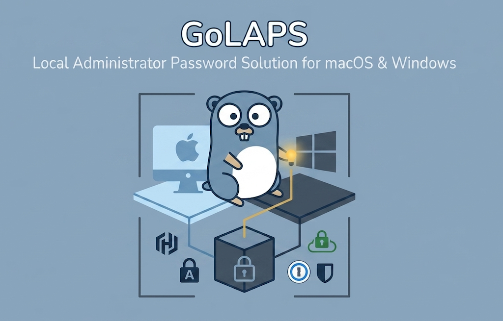
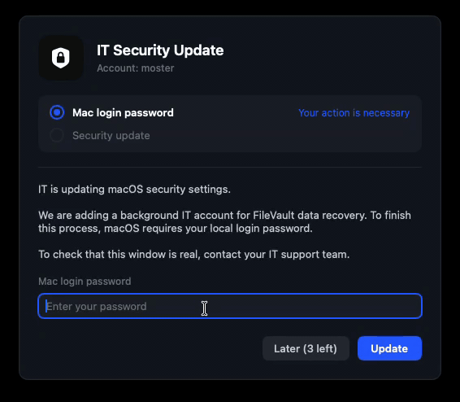

<p align="center">
  
</p>

# GoLAPS

[](LICENSE)
[](go.mod)
[]()

GoLAPS rotates managed local administrator passwords on **macOS (Apple Silicon)** and **Windows (x64)** fleets. It stores the new credential in your vault provider before it changes the device account.

You can deploy GoLAPS with any MDM platform, such as [Fleet](docs/fleet-mdm.md), Kandji, Jamf Pro, Microsoft Intune, Mosyle, or SimpleMDM.

---

## Supported Vault Providers

| Provider | `LAPS_VAULT_TYPE` | Notes |
| :--- | :--- | :--- |
| **1Password** | `onepassword` | Official 1Password Go SDK (Service Account Token), jittered retries, idempotent item creation |
| **HashiCorp Vault** | `hashicorp` | Supports **KV v2** (`secret/data/...`) and **KV v1** mounts |
| **AWS Secrets Manager** | `aws` | AWS SDK v2 default credential chain and optional `AWS_ENDPOINT_URL` (VPC endpoints, LocalStack, or Moto) |
| **Azure Key Vault** | `azure` | Service Principal (`azidentity`) or custom `azcore.TokenCredential` |
| **Bitwarden Secrets Manager** | `bitwarden` | Official `github.com/bitwarden/sdk-go/v2` (opt-in via `CGO_ENABLED=1 go build -tags=bitwarden_sdk`) |

See [docs/configuration.md](docs/configuration.md) for full provider configuration.

---

## macOS Native Auth Window (`golaps_auth`)

On Apple Silicon Macs, the managed administrator account can lack a Secure Token. If a silent grant fails, GoLAPS opens a native **SwiftUI + AppKit** window (`/usr/local/bin/golaps_auth`) instead of `osascript`:

<p align="center">
  
</p>

- **Zero plaintext in stdout or argv**: the window sends the password over a root-owned Unix socket (`/var/run/golaps_auth.sock`). Both sides check peer UID with `getpeereid` and `LOCAL_PEERCRED`.
- **Phishing-resistant**: GoLAPS compiles all prompt text into the binary. External requests carry only numeric counters and flags.
- **Controlled escalation**: the window supports deferral budgets (`/var/db/golaps/token_prompt.json`) and screen-block escalation with an optional backdrop (`/usr/local/golaps/backdrop.jpg`). It also tracks wrong-password streaks and integrates with **Admin By Request** ([docs/admin-by-request.md](docs/admin-by-request.md)).

---

## Quick Start

Build the macOS `.pkg` (`golaps`, `mac_helper`, and `golaps_auth`) and the Windows `.exe` (with `.sha256`):

```bash
./scripts/build/build.sh
```

Install the macOS package so that root owns the binaries and `trustedBinary` checks pass:

```bash
sudo installer -pkg release/golaps_v<version>.pkg -target /
```

Run GoLAPS and pass secrets over `stdin`. The `--secrets-from-stdin` flag keeps tokens out of `ps` and environment blocks:

```bash
printf '%s\n%s\n' "$LAPS_VAULT_TOKEN" "$LEGACY_ADMIN_PASS" | sudo \
  LAPS_ADMIN_USER="example-admin" \
  LAPS_VAULT_TYPE="hashicorp" \
  LAPS_VAULT_ID="laps" \
  VAULT_ADDR="https://vault.example.com" \
  /usr/local/bin/golaps --secrets-from-stdin
```

---

## Architecture & Security Highlights

Password rotation is irreversible, and the vault holds the only copy of the new password. GoLAPS follows these rules:

- **Escrow-first with recovery candidates**: GoLAPS writes the new password to `pending_password` before it rotates the OS account. It also keeps any displaced value in `previous_pending_password`. After an interrupted run, `VerifyPassword` checks which stored candidate works before GoLAPS stages a new value.
- **Native Swift helper (`mac_helper`)**: a minimal Swift helper runs privileged OpenDirectory and `sysadminctl` actions. It reads secrets from `stdin` only and returns structured outcomes (`ok`, `od-error`, `auth-failed`, `locked`, `reset-refused`, `policy-rejected`). The helper also detects phantom `sysadminctl` resets (exit `0` despite an opendirectoryd refusal) by output markers.
- **Secure Token and bridge safety**: GoLAPS never runs an administrative reset on a Secure Token holder. Token-less accounts rotate in place without daily recreation. If GoLAPS must recreate the last admin on a Mac, `withBridgeAdmin` escrows a temporary `laps-bridge` password first and refuses if no local token holder exists.
- **Preflight and hardening**: GoLAPS uses an exclusive run lock (`/var/run/golaps.lock` on Unix, `LockFileEx` on Windows) and sets `RLIMIT_CORE=0`. Before rotation, it checks helper ownership (`trustedBinary`), battery level, failed-login conflicts (threshold `5`), and a 7-day heal cooldown (`/var/db/golaps/last_heal`).
- **Policy-compliant passwords**: the `crypto/rand` generator creates 16–64 character passwords with 1–3 symbols, uppercase letters, lowercase letters, and digits. It follows macOS `allowSimple=false` rules (no doubled characters and no 3-character runs).
- **Hardened Windows agent**: GoLAPS runs PowerShell by absolute path with a clean environment and passes the password over `stdin` into `ConvertTo-SecureString`. It checks and updates the Administrators group by SID `S-1-5-32-544`, requires `LAPS_RESULT=OK` on `stdout`, and rejects OEM placeholder serials.

Details: [docs/architecture.md](docs/architecture.md) · [docs/building.md](docs/building.md)

---

## Building & Code Signing

`scripts/build/build.sh` compiles GoLAPS with `-trimpath -ldflags="-s -w"`. It checks Go downloads by SHA-256 and signs macOS binaries with Hardened Runtime (`--options runtime`) and explicit bundle identifiers.

For production MDM deployment, provide your Apple Developer ID identities:

```bash
CODESIGN_IDENTITY="Developer ID Application: Your Org (TEAMID)" \
INSTALLER_IDENTITY="Developer ID Installer: Your Org (TEAMID)" \
GOLAPS_VERSION="1.0.0" \
./scripts/build/build.sh
```

---

## Repository Layout

- [cmd](cmd) — entrypoint, capabilities, run locks, and log rotation.
- [internal/config](internal/config) — managed preferences (`io.github.golaps`), environment variables, and `--secrets-from-stdin` loading.
- [internal/core](internal/core) — rotation orchestrator and candidate checks.
- [internal/osmgmt](internal/osmgmt) — macOS and Windows managers, Swift `mac_helper.swift`, and SwiftUI `auth_window.swift`.
- [internal/password](internal/password) — `crypto/rand` password generator.
- [internal/vault](internal/vault) — 1Password, HashiCorp Vault, AWS, Azure, and Bitwarden clients.
- [scripts/build](scripts/build) & [scripts/mdm](scripts/mdm) — release build script and hardened MDM trigger and audit scripts.
- [profiles/macos](profiles/macos) & [configs/examples](configs/examples) — example `.mobileconfig` and configuration templates.
- [docs](docs) — architecture, configuration, building, and Admin By Request guides.

---

## Security Notes

- Never commit real tokens, `.env` files, vault IDs, or internal profiles to Git.
- Always pass vault tokens over `--secrets-from-stdin` (see [scripts/mdm/macos/laps_token.sh](scripts/mdm/macos/laps_token.sh) and [laps_token_minimal.sh](scripts/mdm/macos/laps_token_minimal.sh)).
- Sign and notarize production `.pkg` releases with `CODESIGN_IDENTITY` and `INSTALLER_IDENTITY`.

## License

GoLAPS uses the MIT License. See [LICENSE](LICENSE) for details.
